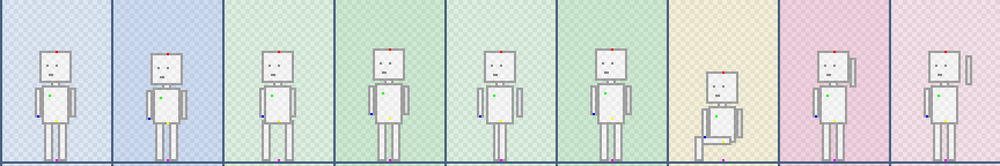
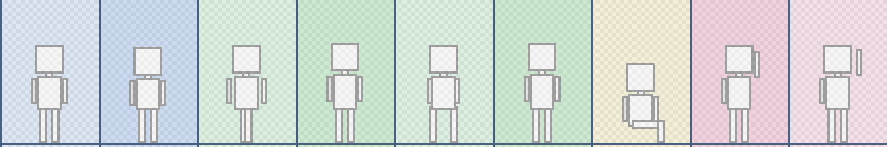
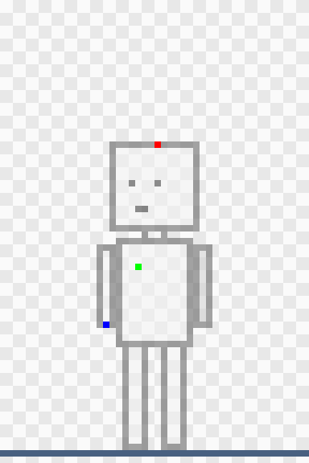
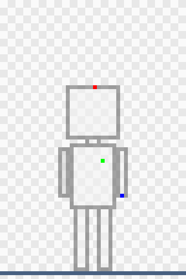
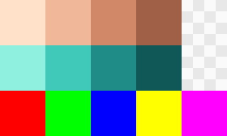

# Drawing avatars and clothes for Hushfield

How residents and the clothes they wear are drawn. **Start with the test in
step 1** and send it to Luigi before drawing anything else: it decides
whether the size and the number of frames below are right, and every piece
of clothing depends on them.
Drawing something else? See [all the art guides](README.md).

> **In the game on stand-ins.** Avatars already walk, sit, wave and wear
> clothes in the game, drawn with plain placeholder art. Each file you send
> replaces a placeholder of the same name, so you can see your work in the
> game straight away.

## How an avatar works

A resident is a **base body** with **clothes layered on top**, like a paper
doll. Everything is drawn on the same **48 × 72** frame, at half size like
the rest of the game, with the feet in the same place in every frame.

- **Two facings are drawn:** **front**, turned towards the lower left, and
  **back**, turned towards the upper right. The game mirrors them for the
  other two directions, so a front-left avatar flipped becomes front-right.
- **Each facing is a strip of 9 frames**, side by side, always in this
  order. The templates tint each frame by its animation:

    | Frames | Animation | Template tint | Notes                                         |
    | ------ | --------- | ------------- | --------------------------------------------- |
    | 1–2    | idle      | blue          | standing still; a breath or a blink           |
    | 3–6    | walk      | green         | step, pass, step, pass; loops back to frame 3 |
    | 7      | sit       | yellow        | used on chairs and on the floor               |
    | 8–9    | wave      | pink          | an arm up, two positions                      |

    A strip is 9 × 48 = **432 × 72**.

- **Clothes on the body and feet** (shirts, coats, trousers, shoes) are
  drawn in **every frame**, because arms and legs move.
- **Hair, hats, glasses, pins and held things** are drawn **once per
  facing**, as a single 48 × 72 frame. The game moves them to follow the
  head, chest or hand in each frame, so a hat bobs with the walk without
  being redrawn.

## The templates

Every template is in [`templates/avatars/`](templates/avatars/), at 100%.
Open one in Aseprite with _File → Import Sprite Sheet_, **48 × 72** frames,
and each frame becomes an animation frame you can play with Enter. Put your
drawing on a new layer above the template.

| Template                                    | For                                                          | Size     |
| ------------------------------------------- | ------------------------------------------------------------ | -------- |
| `body-front.png`, `body-back.png`           | the base body, and its anchors                               | 432 × 72 |
| `clothes-front.png`, `clothes-back.png`     | body and feet clothes, and capes                             | 432 × 72 |
| `accessory-front.png`, `accessory-back.png` | hair, hats, glasses, pins and held things                    | 48 × 72  |
| `palette.png`                               | the colours to paint skin, recolourable parts and anchors in |          |

Each shows a **faded body** to draw over, a **blue line** for the ground
the feet stand on, and the **anchors** as single bright pixels.

| Accessory, front                                                    | Accessory, back                                                   | Palette                                            |
| ------------------------------------------------------------------- | ----------------------------------------------------------------- | -------------------------------------------------- |
|  |  |  |

> **The faded body is a placeholder for now.** Once your base body is in,
> Luigi makes the templates again and the clothes and accessory templates
> show **your** body. Draw the base body first; wait for the new templates
> before drawing clothes.

## 1. The test: one body strip and one hat

Draw just this, and send it:

1. **The base body, front facing, frames 1–6** (idle and walk) on
   `body-front.png`. Bald, no clothes, in the skin colours from
   `palette.png`. Leave frames 7–9 empty for now.
2. **One hat, front facing**, on `accessory-front.png`, sitting on the head
   of frame 1.

Luigi will put them in the game walking over the ground, straight and
diagonally, at the game's real speed. The questions it answers:

- Does a face read at this size?
- Do 4 walk frames look smooth enough, or choppy?
- Does the mirrored avatar look right walking the other way?

If any answer is no, the sizes or frame counts change before you draw
anything else, which is why the rest of this guide waits.

## 2. The base body

- Draw **both facings, all 9 frames**: `base/front.png` and `base/back.png`.
- **Feet on the blue line** in every frame, including the sit frame.
- **Paint the skin only in the four skin colours** on the first row of
  `palette.png`, light to dark. The game swaps them for each resident's skin
  tone, so any other colour wouldn't change. Eyes, mouth and outline may be
  any colour.
- **Mark the anchors.** On a separate layer, put **one pixel** of each
  anchor colour (the third row of `palette.png`) in **every frame**:

    | Anchor | Colour  | Put it                                   |
    | ------ | ------- | ---------------------------------------- |
    | head   | red     | top middle of the head, where a hat sits |
    | chest  | green   | where a pin goes                         |
    | hand   | blue    | in the hand that holds things            |
    | hip    | yellow  | the seat, where the body sits            |
    | feet   | magenta | between the feet, on the ground          |

    The template shows where the placeholder's anchors are. Move them with
    your body: when the head bobs down a pixel in a frame, so does its red
    pixel. Export that layer alone as the same strip:
    `base/front-anchors.png` and `base/back-anchors.png`.

## 3. Hair

- One 48 × 72 frame per facing, on the accessory templates, fitted to the
  head of **frame 1**: `hair/{style}/front.png` and `back.png`, such as
  `hair/short/front.png`.
- The game moves it with the red head anchor, so draw it only once.

## 4. Clothes and accessories

| Slot                            | Template            | Draw                             | Files                                          |
| ------------------------------- | ------------------- | -------------------------------- | ---------------------------------------------- |
| Body (shirts, coats), feet      | `clothes-*.png`     | all 9 frames, both facings       | `items/{slug}/front.png`, `back.png`, 432 × 72 |
| Head, face, pin, hand           | `accessory-*.png`   | one frame per facing             | `items/{slug}/front.png`, `back.png`, 48 × 72  |
| Anything behind the body (cape) | `clothes-front.png` | the part behind, as its own file | `items/{slug}/front-behind.png`                |

The **slug** is the item's name in lowercase with hyphens, as the admin
catalog shows it: `wool-cap`, `municipal-raincoat`.

- **Accessories go on frame 1's anchor:** a hat on the red pixel, a pin on
  the green one, a held thing gripped at the blue one. The game moves them
  from there, so anything placed off its anchor stays off it in every frame.
- **Clothes follow the body frame by frame:** sleeves move with the arms,
  trouser legs and shoes with the legs, the raised arm in frames 8–9 and
  the bent legs in frame 7 included.
- **Colours that change** (the red of a red beanie) go in the **recolour
  colours**, the second row of `palette.png`, light to dark, so one drawing
  sells in every colour. Parts that never change can be any colour.
- **Hats:** tell Luigi whether a hat **hides the hair** under it.
- **Face items** (glasses) aren't seen from the back; skip `back.png`.
- **Held things** are drawn as if gripped by the hand; the game draws the
  hand over them.
- **Capes:** the front of the cape (its collar) goes in `front.png` like any
  coat; the part seen behind the body goes in `front-behind.png`. From the
  back the whole cape is in `back.png`.
- **Nothing leaves the 48 × 72 frame**, however tall the hat.

### Rules that come from mirroring

- **Light comes from the front**, or keep shading flat, not from the top
  left as on buildings: mirrored, a top-left light would jump to the top
  right.
- **Draw things symmetric, and no writing.** A pin on the left chest is on
  the right chest when mirrored, and writing comes out backwards. If an
  item really must be lopsided, ask Luigi first: it needs its own drawing
  for the mirrored side.

## 5. Export

- Hide the template layer, and every layer but the one being exported.
- _File → Export Sprite Sheet_ for strips: **horizontal**, trim **off**,
  padding **none**, scale **100%**. One PNG per strip, not one per frame.
- _File → Export As…_ for single frames: PNG, scale 100%.
- Transparent background, **solid pixels only**, no smoothing.
- Names: lowercase, words joined with hyphens, as the tables above.

## 6. Send it to Luigi

Avatars and clothes go out with the game's code. Send the PNGs, and the
`.aseprite` too if you like.

## If the build says no

Luigi sees these when he puts your files in; they say what to fix.

| The message says                                         | What to do                                                                                       |
| -------------------------------------------------------- | ------------------------------------------------------------------------------------------------ |
| "is 864×144 … already scaled up … Export it at 100%"     | Export again at scale 100%.                                                                      |
| "is 480×72; it must be 9 frames of 48 × 72 side by side" | Wrong canvas or padding on. Export with padding none and trim off, from the template.            |
| "it must be one frame, 48 × 72"                          | An accessory or hair exported as a strip. Export the single frame.                               |
| "has a half-transparent pixel"                           | Make that pixel fully solid or fully clear. Check antialiasing is off.                           |
| "Frame 5 of the avatar's anchors has no hand anchor"     | That frame is missing its blue pixel. Every frame needs all five anchors.                        |
| "has two head anchors" or "a pixel that marks no anchor" | The anchors layer has an extra pixel, or a colour that's slightly off. Use only `palette.png`'s. |
| "Avatar art needs art/avatars/base/back-anchors.png"     | A facing is missing its anchors strip. Send it with the body.                                    |

---

_For developers: the design behind this brief is §14 of
[`docs/assets-plan.md`](../assets-plan.md); it wins if they disagree. The
templates come from `php docs/art/templates/make-templates.php`, reading
`resources/art/avatars/rig.json` (frame, animations, anchors, palette) and
the base body there; run it again when her base body lands. The stand-ins
come from `php docs/art/templates/make-avatar-standins.php`. The skin and
recolour swaps aren't built yet: until they are, the game tints the whole
base body with the resident's colour, and recolour colours show as painted._
