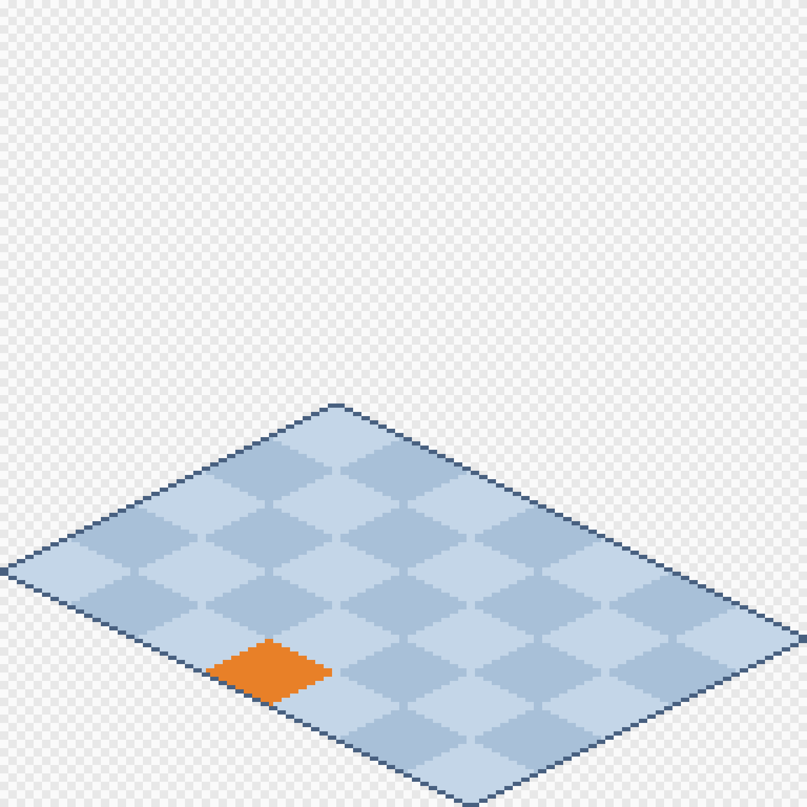

# Drawing buildings for Hushfield

How to draw a building's outside and get it into the game. It works like
[furniture](furniture.md), with two differences: a building is **one
picture** (buildings never turn), and you **send it to Luigi** instead of
uploading it.

## 1. Pick the template

Each building stands on a block of tiles on the street, **wide** × **deep**.
Open its template from [`templates/buildings/`](templates/buildings/):

| Building       | File             | Tiles | Canvas width | Door                         |
| -------------- | ---------------- | ----- | ------------ | ---------------------------- |
| Public Library | `library.png`    | 7 × 5 | 192          | lower-left face, middle tile |
| The VFA        | `vfa.png`        | 7 × 5 | 192          | lower-left face, middle tile |
| Coin Laundry   | `laundromat.png` | 5 × 4 | 144          | lower-right face, 3rd of 4   |
| WHSH           | `whsh.png`       | 4 × 4 | 128          | lower-left face, 3rd of 4    |

The canvas is always **(wide + deep) × 16** pixels across, and the width
must match exactly. A new building gets its template when Luigi adds it to a
map.

## 2. Draw on the diamond

Put your drawing on a layer above the template.

- **The building stands on the diamond, and nothing may go below it.** Its
  walls start at the diamond's edges: each tile is **16 pixels** along an
  edge, so the Library's lower-left face is 112 pixels long.
- **Only the two front faces show**: the lower left and the lower right.
  Players never see the back, so don't draw it.
- **The orange tile is the door.** Paint the doorway on the face, over that
  tile. Players walk to that tile to go inside.
- **Light comes from the top left.** The lower-left face is lit; the
  lower-right face is in shade.
- Draw at **half size**, like the tiles and furniture: the game doubles every
  pixel.
- **Make it as tall as you like.** The template leaves some room for a roof;
  extend the canvas upwards for more (keep the width). Roofs, signs and
  chimneys can stick up as far as you want.
- You don't draw the inside. Going through the door loads the inside as its
  own room.

Players walk behind buildings, and the game hides them correctly, so one
whole picture is right: don't cut it into pieces.

## 3. Export

- **PNG** with a **transparent background**, at **100%**. Don't scale it up;
  the game does that. In Aseprite: _File → Export As…_, PNG, scale 100%.
- **No smoothing.**
- Hide or delete the template layer first.
- Name it like its template: `library.png`, `vfa.png`, `laundromat.png`,
  `whsh.png`.

## 4. Send it to Luigi

Buildings go out with the game's code, not through the admin site. Send the
PNG to Luigi; he adds it and it appears after the next deploy. Until then
the building is a plain coloured block.

## If it's refused

| The message says…                            | What it means and how to fix it                                                                                                   |
| -------------------------------------------- | --------------------------------------------------------------------------------------------------------------------------------- |
| "is 128×176; it must be 192 wide"            | Wrong canvas width for that building. Start again from its template. Don't resize the picture: that squashes the angles.          |
| "has pixels below its footprint diamond at…" | Something hangs below the diamond, usually a wall drawn longer than its tiles. Shorten it until the base sits inside the diamond. |
| "is already scaled up"                       | It was exported at 200% or more. Export at 100%.                                                                                  |

---

_For developers: the rules behind this guide are in "Buildings, furniture and
walls" in [`resources/maps/README.md`](../../resources/maps/README.md#buildings-furniture-and-walls),
which wins if the two disagree. The templates come from
`php docs/art/templates/make-templates.php`, which reads each building's size
and door from the maps. Her art goes in `resources/art/buildings/{slug}.png`,
with an entry in `resources/art/provenance.json`._
