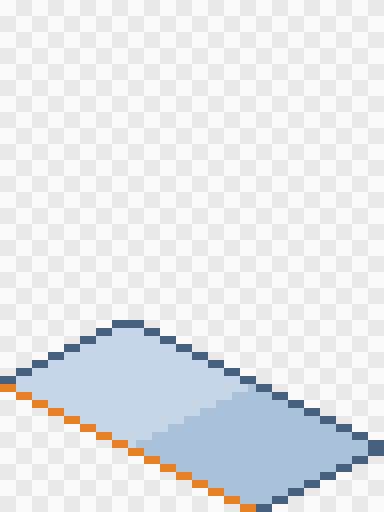
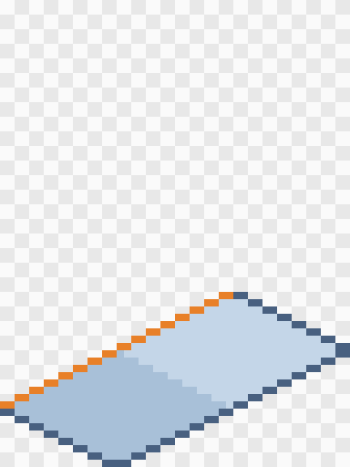
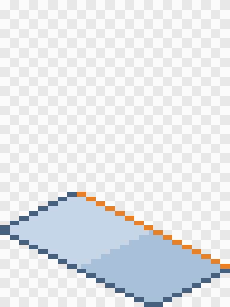
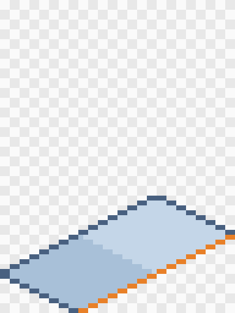
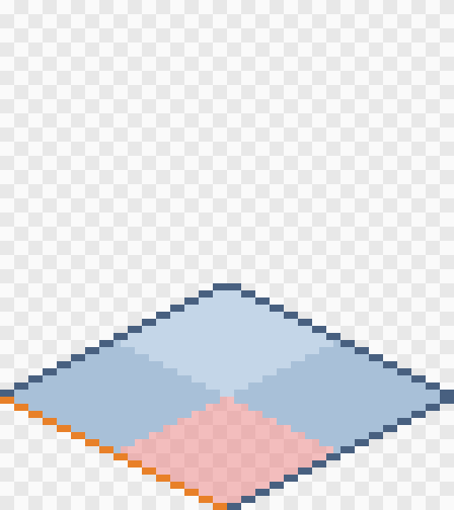
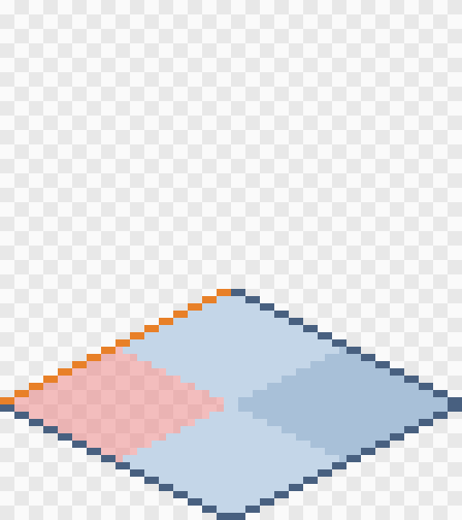
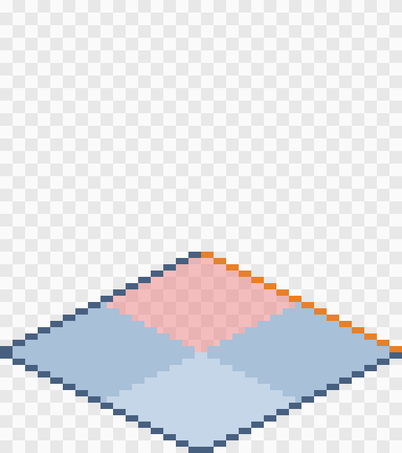
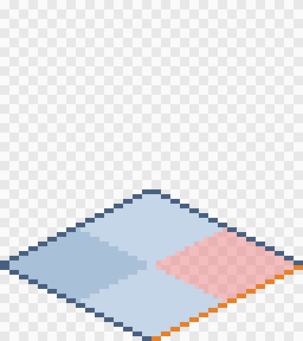
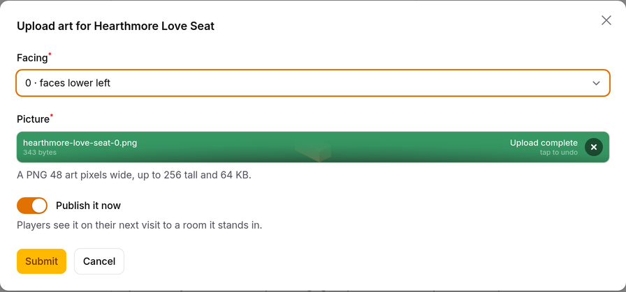

# Drawing furniture for Hushfield

This guide is for the artist. It covers how big to make a piece of
furniture, where it stands on the canvas, which ways it faces, and how to
upload it. The developers' version of the same rules is "Buildings,
furniture and walls" in [`resources/maps/README.md`](../../resources/maps/README.md#buildings-furniture-and-walls).
If the two ever disagree, the README is right; tell us and we'll fix this guide.

## The short version

- Draw at **half size**. The game doubles every pixel, so your pixels match
  the ground tiles.
- The canvas is **(wide + deep) × 16 pixels across**. A 1 × 1 stool is 32
  across, a 2 × 1 love seat 48.
- The piece stands on a **diamond at the bottom of the canvas**, its footprint.
  Nothing may hang below it.
- Make it **as tall as it needs**, up to 256 pixels.
- **Light comes from the top left.**
- Export a **PNG** at **100%**, with a **transparent background**. Don't scale
  it up, and don't smooth it.
- One picture per **facing** (0 to 3). Mirroring can save you some of them.

The templates in [`templates/`](templates/) have the diamond already drawn
for common sizes. Open one, put your drawing on a layer above it, and hide or
delete the template layer before you export.

## Sizes: wide and deep

Every piece covers a block of floor tiles: **wide** tiles one way and
**deep** tiles the other. We tell you both for each item; they're also on the
item's page in the admin catalog ("Tiles wide" and "Tiles deep").

The canvas is **(wide + deep) × 16** pixels across, whichever way the piece
faces. The height is up to you.

| Piece             | Wide × deep | Canvas width | Templates                                  |
| ----------------- | ----------- | ------------ | ------------------------------------------ |
| Stool, plant      | 1 × 1       | 32           | `1x1-facing-0.png` … `-3.png`              |
| Love seat, bench  | 2 × 1       | 48           | `2x1-facing-0.png` … `-3.png`              |
| Bed, square table | 2 × 2       | 64           | `2x2-facing-0.png` … `-3.png`              |
| Sofa, counter     | 3 × 1       | 64           | `3x1-facing-0.png` … `-3.png`              |
| Big table         | 3 × 2       | 80           | `3x2-facing-0.png` … `-3.png`              |
| Square rug        | 3 × 3       | 96           | `3x3-facing-0.png` … `-3.png`              |
| Long sofa, shelf  | 4 × 1       | 80           | `4x1-facing-0.png` … `-3.png`              |
| Dining table      | 4 × 2       | 96           | `4x2-facing-0.png` … `-3.png`              |
| Large rug         | 4 × 3       | 112          | `4x3-facing-0.png` … `-3.png`              |
| Big rug           | 4 × 4       | 128          | `4x4-facing-0.png` … `-3.png`              |
| Corner Sofa       | 2 × 2, an L | 64           | `corner-sofa-facing-0.png` … `-3.png`      |
| Long corner sofa  | 4 × 2, an L | 96           | `long-corner-sofa-facing-0.png` … `-3.png` |

Need a size that isn't here? Ask us. The templates come from a small
script, so making more takes a minute.

## The footprint diamond

The piece stands on its footprint: the diamond of floor tiles it covers,
drawn at the bottom of the canvas.

- The diamond is half as tall as the canvas is wide: (wide + deep) × 8.
- Its **bottom point** touches the bottom edge of the canvas.
- Its **left and right points** touch the left and right edges.
- Its edges go up 1 pixel for every 2 across, like the ground tiles.
- **Nothing may be drawn below the diamond.** Everything else stands on it
  and rises above it.

This is the 2 × 1 love seat's template at facing 0, enlarged. The orange edge
is the side the piece faces. The grey and white checks are empty canvas.

## Facings

Players turn furniture in quarter turns, so a piece can have four pictures,
numbered 0 to 3:

| Facing | The piece faces…                      | You see its… |
| ------ | ------------------------------------- | ------------ |
| 0      | the lower left, towards the viewer    | front        |
| 1      | the upper left, away from the viewer  | back         |
| 2      | the upper right, away from the viewer | back         |
| 3      | the lower right, towards the viewer   | front        |

The template for each facing marks its front edge in orange. For a piece
that isn't square, such as a 2 × 1 love seat, the diamond also changes
between facings: at facings 0 and 2 the long side runs down to the left,
and at 1 and 3 it runs down to the right.

| Facing 0                                         | Facing 1                                         | Facing 2                                         | Facing 3                                         |
| ------------------------------------------------ | ------------------------------------------------ | ------------------------------------------------ | ------------------------------------------------ |
|  |  |  |  |

### When mirroring saves you a facing

If a facing has no picture, the game flips another facing left to right:

- **0 and 3 mirror each other** (both fronts).
- **1 and 2 mirror each other** (both backs).
- If neither picture exists, it shows the opposite facing as it is, so a
  back view uses the front picture.

So for most pieces, **draw facing 0 and facing 1**, and the game makes 3
and 2 from them. A piece that looks the same from the front and the back,
such as a round table, a plant or a lamp, needs **only facing 0**.

Draw a facing yourself when the mirrored version would look wrong:

- **Light.** A flipped picture has its light coming from the top _right_. On
  most pieces you won't notice. If it shows, draw that facing too.
- **Writing, or one-sided details**, such as a clock face, a sign, or a
  lamp on one end of a desk.
- **Shaped pieces** (next section).

## Shaped pieces, such as the Corner Sofa

Some pieces don't cover their whole block. The Corner Sofa is 2 × 2, but
it's an L shape: one of its four tiles is open floor, where players can walk
and a side table can stand.

- Draw on the whole block's canvas (64 across for the Corner Sofa).
- **Leave the open tile's floor transparent.** It's red in the template.
  Parts of the piece standing in front of it may rise up over it, which is fine.
- **Mirroring almost never works for shaped pieces.** Flipping an L puts the
  gap on the wrong tile, so the game won't do it. **Give the Corner Sofa all
  four facings.** A shape that is the same from left to right, such as a
  U-shaped booth, can still mirror 0 into 3. We'll tell you when that applies.

| Corner Sofa, facing 0                                                 | Corner Sofa, facing 1                                                 | Corner Sofa, facing 2                                                 | Corner Sofa, facing 3                                                 |
| --------------------------------------------------------------------- | --------------------------------------------------------------------- | --------------------------------------------------------------------- | --------------------------------------------------------------------- |
|  |  |  |  |

## Light and shading

Light comes from the **top left**, the same as on the ground tiles and
buildings. Sides that face down and to the left are lit. Sides that face
down and to the right are in shade.

## Exporting

- **PNG**, with a **transparent background**.
- **100% size.** Don't export at 200%: the game doubles it already, and the
  upload refuses art that has been scaled up.
- **No smoothing or anti-aliasing** when exporting. Soft, see-through pixels
  you drew on purpose are fine.
- Up to **256 pixels tall** and **64 KB**. Furniture is usually 1 to 3 KB.
- In Aseprite: _File → Export As…_, PNG, scale 100%.

## Naming your files

- To **upload** them yourself (below), the file name doesn't matter, but
  `love-seat-0.png` keeps things tidy.
- To **send** them to us instead, put each item in a folder named by its
  slug, one file per facing, numbered: `items/love-seat/0.png`,
  `items/love-seat/1.png`. A slug is the item's name in lowercase with
  hyphens. Ask us if you aren't sure of one; it's also on the item's page.
  Leave out any facing that mirrors. Send a changed file under the same name;
  don't add `-v2` or `-final`.

## Uploading in the admin catalog

You need a staff account with access to the item catalog. Ask Luigi for one.

1. Sign in at `/admin` on the Hushfield site.
2. Go to **Economy → Item catalog** and open the piece of furniture.
3. Scroll down to **Art**. It shows how wide the canvas must be for this
   piece, and every picture uploaded so far.
4. Press **Upload art**, choose the **facing**, and pick your PNG.
5. If you're the art publisher, leave **Publish it now** on and players will
   see it. If not, Luigi publishes it from the same list.
6. Press **Submit**. The green "Upload complete" bar only means the file
   reached the form. The checks run when you press Submit. If something's
   wrong, such as the wrong width or pixels below the diamond, a red message
   in the corner says what, and you can pick another file.

The list shows each upload's status:

- **Published**: what players see for that facing.
- **Not published**: uploaded, but not shown yet. Publishing it replaces
  whatever that facing shows now.
- **Stale**: the piece has changed size or shape since you drew it, so the
  game no longer shows it. Draw it again for the new size.

Nothing is ever overwritten. To go back to an earlier picture, publish that
row again. **Unpublish** takes a facing out of the game. The game then shows
any version of that facing kept with the game's code, or a plain coloured
block if there is none.

Players see new art the next time they enter a room where the piece stands.

## Colour variants

Some pieces come in more than one colour, such as the Hearthmore Love Seat in
Rose, Moss and Slate. In the shop they're one entry, and players pick the
colour from a row of swatches. Behind the scenes each colour is its own item,
with its own art.

Every colour stands on the same tiles as the original, so draw a colour by
**recolouring the finished piece**:

1. Start from the finished, approved art for the original colour, every
   facing you drew.
2. Change only the colours: the fabric, the paint, the wood. Keep the
   outline, the shading direction and the highlights where they are.
3. Keep the **same canvas** and the **same facings**. The width, the height
   and where the piece stands on its diamond don't change. If you mirrored a
   facing for the original, mirror it for the colour too.
4. Name the files as above, under the colour's own slug, which is the
   original's slug and the colour: `items/hearthmore-love-seat-moss/0.png`.

To upload, open the original piece in the **Item catalog** and scroll to
**Variants**. Each colour has an **Edit and art** button that opens its page,
with the same **Art** list as above. Staff add a new colour there with
**Add a colour**, which asks for its name, its swatch and its price. A new
colour starts out of the shop, so its art can go up before anyone buys it.

If the original piece changes size or shape, every colour changes with it,
and all their art goes stale together.

## How it looks in the game

The game cuts each picture into thin vertical strips, so players can walk
behind tall furniture and be hidden by it. You don't need to do anything
for this. Just draw the whole piece in one picture.
