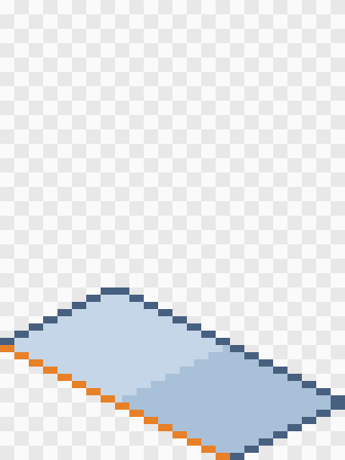
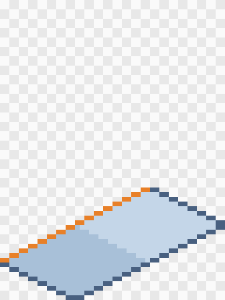
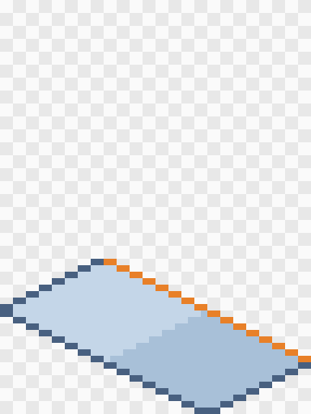
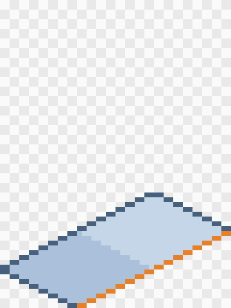
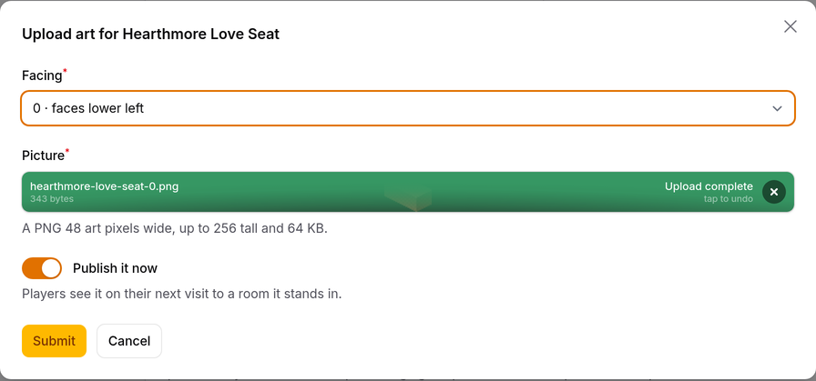

# Drawing furniture for Hushfield

How to draw a piece of furniture and get it into the game, in five steps,
and a sixth if it [switches on](#6-a-piece-that-switches-on), like a washer
that tumbles. This is furniture residents buy for their homes. A room's own
machines and tables, such as the Coin Laundry's washers, are
[room pieces](room-pieces.md): drawn the same way, but sent to Luigi and
placed in Tiled. Drawing something else? See
[all the art guides](README.md).
If an upload is refused, the [last table](#if-the-upload-says-no) says why
and how to fix it.

## 1. Pick the template

Every piece covers a block of floor tiles, **wide** × **deep**. Ask Luigi, or
look on the item's page in the admin catalog ("Tiles wide" and "Tiles deep").
Then open the matching template from
[`templates/furniture/`](templates/furniture/):

| Size        | Canvas width | Template                              | For example        |
| ----------- | ------------ | ------------------------------------- | ------------------ |
| 1 × 1       | 32           | `1x1-facing-0.png` … `3`              | stool, plant, lamp |
| 2 × 1       | 48           | `2x1-facing-0.png` … `3`              | love seat, bench   |
| 2 × 2       | 64           | `2x2-facing-0.png` … `3`              | bed, square table  |
| 3 × 1       | 64           | `3x1-facing-0.png` … `3`              | sofa, counter      |
| 3 × 2       | 80           | `3x2-facing-0.png` … `3`              | big table          |
| 3 × 3       | 96           | `3x3-facing-0.png` … `3`              | square rug         |
| 4 × 1       | 80           | `4x1-facing-0.png` … `3`              | long sofa, shelf   |
| 4 × 2       | 96           | `4x2-facing-0.png` … `3`              | dining table       |
| 4 × 3       | 112          | `4x3-facing-0.png` … `3`              | large rug          |
| 4 × 4       | 128          | `4x4-facing-0.png` … `3`              | big rug            |
| 2 × 2, an L | 64           | `corner-sofa-facing-0.png` … `3`      | Corner Sofa        |
| 4 × 2, an L | 96           | `long-corner-sofa-facing-0.png` … `3` | Issued Armchair    |

The canvas is always **(wide + deep) × 16** pixels across. Need a size that
isn't here? Ask; making one takes a minute.

## 2. Draw on the diamond

Put your drawing on a layer above the template.

- **The piece stands on the diamond, and nothing may go below it.** The
  diamond is the floor the piece covers. Its base should fill the diamond,
  no longer and no shorter: each tile is **16 pixels across** along an edge,
  so a 4-tile sofa's long side spans 64 pixels.
- The **orange edge** is the side the piece faces.
- **Red tiles** are open floor in a shaped piece, such as the gap in an L
  sofa. Leave their floor transparent. Parts of the piece in front may rise
  over them.
- **Light comes from the top left.** Sides facing down-left are lit; sides
  facing down-right are in shade.
- Draw at **half size**: the game doubles every pixel. Make it as **tall** as
  it needs, up to 256 pixels.

## 3. Draw the facings you need

Players turn furniture, so a piece has up to four pictures, one per template:

| Facing | Faces           | You see its |
| ------ | --------------- | ----------- |
| 0      | the lower left  | front       |
| 1      | the upper left  | back        |
| 2      | the upper right | back        |
| 3      | the lower right | front       |

| Facing 0                                                   | Facing 1                                                   | Facing 2                                                   | Facing 3                                                   |
| ---------------------------------------------------------- | ---------------------------------------------------------- | ---------------------------------------------------------- | ---------------------------------------------------------- |
|  |  |  |  |

The game flips a missing facing from its mirror: **0 ↔ 3** and **1 ↔ 2**. So:

- **Most pieces:** draw **0 and 1**.
- **Same from every side** (round table, plant, lamp): draw **0** only.
- **Shaped pieces** (L sofas): draw **all four**. A flipped L has its gap on
  the wrong tile.
- Also draw a facing yourself if the flip looks wrong: writing, a clock face,
  something on one end only, or light that obviously comes from the right.

## 4. Export

- **PNG** with a **transparent background**, at **100%**. Don't scale it up;
  the game does that. In Aseprite: _File → Export As…_, PNG, scale 100%.
- **No smoothing.**
- Hide or delete the template layer first.
- File names don't matter for uploading, but `sofa-0.png`, `sofa-1.png` keeps
  things tidy.

## 5. Upload

You need a staff account; ask Luigi.

1. Sign in at `/admin` on the Hushfield site.
2. Go to **Economy → Item catalog** and open the piece.
3. Scroll to **Art**. It shows the canvas width this piece needs.
4. Press **Upload art**, choose the **facing**, pick your PNG, press **Submit**.
   ("Upload complete" only means the file reached the form; the checks run on
   Submit.)
5. If you can publish, leave **Publish it now** on. Otherwise Luigi publishes
   it from the list.

Players see it the next time they enter a room with the piece. Nothing is
ever overwritten: to go back, publish an older row again. A row marked
**Stale** was drawn for an old size or shape; draw it again.

**Colours** (such as the Love Seat in Rose, Moss and Slate) are separate items
with their own art. Recolour the finished piece and change nothing else: same
canvas, same facings. Upload from the original's page, under **Variants →
Edit and art**.

## 6. A piece that switches on

A piece can have a moving part that plays while it's **on**, such as clothes
tumbling in a washer. Anyone in the home, the owner or a visitor, taps the
piece to switch it on or off, and everyone there sees it. A new piece starts
off. Rugs and other floor pieces can't switch on yet.

1. **Draw the moving part** over the picture, exactly as for a room piece:
   only what moves, two or more frames each the size of the picture, frame 1 good
   on its own. See [room pieces, step 2b](room-pieces.md#2b-moving-parts-a-washer-thats-on).
2. **Upload it with its picture.** In **Upload art**, add the strip under
   **Switched on** and fill in **Frame times (ms)**: one time for every frame
   (`140`), or one for each (`600, 80, 80, 80`). Each frame shows for at
   least 60 ms.
3. The picture and its animation are one row, published and rolled back
   together. To change the animation, upload the picture again with the new
   strip.
4. **Other colours** (Variants) need the animation too. Draw it once: on the
   row with the animation, press **Copy animation to colours…** and pick the
   colours. Each gets its own picture with your animation, as a new row. A
   colour needs its picture for that facing uploaded first, at the same size.
   If the moving part is itself coloured, like a lamp's glow, upload that
   colour's own strip instead.

The mirrored facing gets the animation mirrored for free, as it gets the
picture. A piece needs an animation on at least one facing it shows to be
switchable.

## If the upload says no

| The message says…                              | What it means and how to fix it                                                                                                                                                                                                                                    |
| ---------------------------------------------- | ------------------------------------------------------------------------------------------------------------------------------------------------------------------------------------------------------------------------------------------------------------------ |
| "is 128×64; it must be 96 wide"                | The canvas is the wrong width. Start again from the right template. Don't resize the picture to fit: that squashes the angles.                                                                                                                                     |
| "has pixels below its footprint diamond at…"   | Something hangs below the diamond, usually because the piece is drawn **longer** than its tiles. Put the template back under it and shorten the piece until its base sits inside the diamond. The (x, y) is the first bad pixel, counted from the top-left corner. |
| "It stands on a 2 × 4 footprint"               | At facings 1 and 3 a long piece turns, so a 4 × 2 sofa becomes 2 × 4. Use that facing's own template.                                                                                                                                                              |
| "is already scaled up" / "far bigger than"     | It was exported at 200% or more. Export at 100%.                                                                                                                                                                                                                   |
| "may be up to 256 tall" / "up to 64 KB"        | Too tall or too big a file. Crop empty space from the top. Furniture is usually 1 to 3 KB.                                                                                                                                                                         |
| "is not a PNG"                                 | Export as PNG.                                                                                                                                                                                                                                                     |
| "needs its frame times"                        | Fill in **Frame times (ms)**: one time, or as many as the strip has frames.                                                                                                                                                                                        |
| "its frames must be 48 × 44, like its picture" | Each frame of the **Switched on** strip is the picture's whole canvas. Start the strip from the picture.                                                                                                                                                           |
| "is too long to load"                          | Too many frames for how wide the moving part is. Use as many frames as the message says, or keep the moving part narrower.                                                                                                                                         |
| "less than 60 ms"                              | A frame flashes by too fast. Make every time 60 or more.                                                                                                                                                                                                           |
| "rugs and other floor pieces can't play"       | Floor pieces can't switch on yet. Upload the picture on its own.                                                                                                                                                                                                   |

Stuck? Send the PNG to Luigi with the message.

---

_For developers: the rules behind this guide are in "Buildings, furniture and
walls" in [`resources/maps/README.md`](../../resources/maps/README.md#buildings-furniture-and-walls),
which wins if the two disagree._
