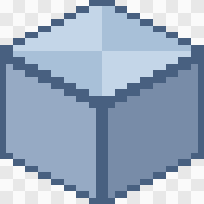
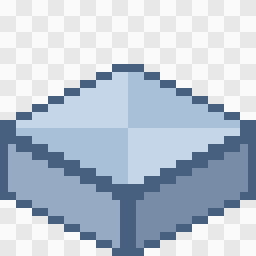

# Drawing ground tiles for Hushfield

How to draw a ground tile (grass, stone, water, wood floor) and get it into
the game. A tile is **one small block** that the game repeats across the
ground, so you draw it once and every map uses it.

## 1. Pick the template

Every tile is drawn on a **32 × 32** canvas. Open the template for its
height from [`templates/tiles/`](templates/tiles/):

| Full cube (`full.png`)                          | Half slab (`half.png`)                          |
| ----------------------------------------------- | ----------------------------------------------- |
|  |  |

- **Full cube**: the ground every map is drawn from. Its top face is a
  32 × 16 diamond on rows 0 to 15, and its sides stand 16 pixels tall.
- **Half slab**: the same tile, half as tall. Its sides stand 8 pixels tall,
  so its top face sits 8 pixels lower. The game doesn't use slabs yet (it
  has no steps up or down), so draw one only when asked.

## 2. Draw on the block

Put your drawing on a layer above the template.

- **The top face is what players walk on**, and it's what shows almost
  everywhere. The sides show mostly along the front edges of a map.
- **Make the top face tile.** The game lays copies edge to edge in a
  diamond grid, so each edge must flow into the opposite one. Test it by
  placing copies **16 across and 8 down** (and 16 across and 8 up) from the
  first, then look for seams.
- **Stand on the bottom of the canvas. Nothing may go below the block.**
- **Light comes from the top left**: the left side is lit, the right side in
  shade.
- **Grass tufts and the like may poke above the top face.**
- Draw at **half size**, like everything else: the game doubles every pixel.

## 3. Name it

Each tile type is a folder, and each height a file in it:
`grass/full.png`, `stone/half.png`. The tiles in the game today:

| Tile                     | Drawn?      | Notes                                             |
| ------------------------ | ----------- | ------------------------------------------------- |
| `grass/full.png`         | ✅          |                                                   |
| `sand/full.png`          | ✅          |                                                   |
| `stone/full.png`         | ✅          |                                                   |
| `stone/half.png`         | ✅          | not on any map yet (no steps)                     |
| `water/full.png`         | ✅          |                                                   |
| `hedge/full.png`         | **not yet** | on every map; still a plain block                 |
| `wood/full.png`          | ✅          | hardwood floors                                   |
| `asphalt/full.png`       | ✅          | the bus stop                                      |
| `asphalt-lines/full.png` | ✅          | the line runs one way; the turned one comes later |
| `bricks/full.png`        | ✅          | the VFA and the yard                              |

A **new kind of tile** needs a name and a place in the game's list first:
ask Luigi before you start. Sending a better version of a tile is always
fine: send it under the same name.

## 4. Export

- **PNG** with a **transparent background**, at **100%**: 32 × 32. In
  Aseprite: _File → Export As…_, PNG, scale 100%.
- **No smoothing.**
- Hide or delete the template layer first.

## 5. Send it to Luigi

Tiles go out with the game's code. Send the PNG (and the `.aseprite` if you
like); it appears after the next deploy. Until a tile has art, the game
draws a plain tinted block in its place.

## If it's refused

| The message says…                                   | What it means and how to fix it                                                                         |
| --------------------------------------------------- | ------------------------------------------------------------------------------------------------------- |
| "is 64×64; it must be 32×32"                        | Wrong canvas size. Start again from the template.                                                       |
| "is already scaled up"                              | It was exported at 200% or more. Export at 100%.                                                        |
| "has pixels below the block's bottom edge at…"      | Something hangs below the block. The (x, y) is the first bad pixel, counted from the top-left corner.   |
| "sides don't reach the bottom of the canvas"        | The block is floating. Move it down so its sides end on rows 24 to 31, like the template's.             |
| "is too short for a full cube … Is it a half slab?" | A `full.png` drawn as a slab. Make its sides 16 tall, or name it `half.png`.                            |
| "is too tall for a half slab"                       | A `half.png` drawn as a full cube. Make its sides 8 tall, or name it `full.png`.                        |
| "isn't a file the build knows" / "has no slot"      | The name or folder isn't one the game knows. Check the table in step 3, or ask Luigi to add a new tile. |

---

_For developers: the rules behind this guide are in "Ground tiles" in
[`resources/maps/README.md`](../../resources/maps/README.md#ground-tiles),
which wins if the two disagree. The templates come from
`php docs/art/templates/make-templates.php`. Her tiles go in
`resources/art/tiles/{type}/{height}.png`, with a slot in
`resources/art/tiles/tiles.json` and an entry in
`resources/art/provenance.json`._
