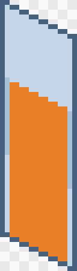

# Drawing walls and wallpaper for Hushfield

How to draw the back walls of a room, such as the wallpaper in every
Hearthmore house, and get them into the game. Like [tiles](tiles.md), a wall
is drawn as **one small panel** that the game repeats along the wall, so you
never draw a whole room. Drawing something else? See
[all the art guides](README.md).

## 1. How walls work

Indoor rooms have two back walls, as in Habbo: one up the **left** side of
the room and one up the **right**. The two front sides stay open so players
can see in.

Each wall is built from **panels one tile wide**, repeated edge to edge. A
**style** is a set of panels, and each room names the style it uses:

| Style       | Where                                     | Panels needed                              |
| ----------- | ----------------------------------------- | ------------------------------------------ |
| `wallpaper` | every house in Hearthmore Residences      | `left`, `right`                            |
| `plaster`   | the Library                               | `left`, `right`, `right-door`              |
| `acoustic`  | WHSH                                      | `left`, `right`, `right-door`              |
| `tiled`     | the Coin Laundry                          | `left`, `right`, `right-door`              |
| `velvet`    | the VFA lobby and both screens            | `left`, `right`, `left-door`, `right-door` |
| `siding`    | the back of the house, seen from the yard | `left`, `left-door`                        |

Until a style has art, its walls are plain tinted blocks.

## 2. Pick the templates

Each style has a folder of templates in
[`templates/walls/`](templates/walls/), with exactly the panels it needs,
named the way you'll name yours: `templates/walls/velvet/` holds
`left.png`, `right.png`, `left-door.png` and `right-door.png`.

| Panel         | File             | Faces                       | Light        |
| ------------- | ---------------- | --------------------------- | ------------ |
| Left wall     | `left.png`       | the viewer's lower right    | **in shade** |
| Right wall    | `right.png`      | the viewer's lower left     | **lit**      |
| Left doorway  | `left-door.png`  | as `left`, with an opening  | in shade     |
| Right doorway | `right-door.png` | as `right`, with an opening | lit          |

A panel is **16 × 56** pixels: one tile edge across, and 48 pixels of wall
above a floor edge that climbs 8 pixels across the panel. `velvet`'s are
taller, **16 × 156**, to hold the VFA's screen.

## 3. Draw on the panel

Put your drawing on a layer above the template.

- **Stand on the floor edge.** The bottom outline is where the wall meets the
  floor: it climbs up to the right on `left` and down to the right on
  `right`. **Nothing may go below it.**
- **The top is 48 above the floor edge** all the way across, so the top
  edge slants the same way as the bottom.
- **Make it tile.** Panels butt edge to edge, so whatever leaves the right
  edge must come back in on the left edge, one step up or down the slope.
  Stripes and patterns should line up across the join. Test it by placing
  three copies side by side, each 8 pixels higher (`left`) or lower
  (`right`) than the last.
- **Light comes from the top left**, as for buildings: `right` is lit,
  `left` is in shade. Draw the same wallpaper on both, darker on `left`.
- **Corners:** the two walls meet behind the room's back corner. A skirting
  board or a top trim should end cleanly at both edges so the corner joins.
- Draw at **half size**, like everything else: the game doubles every pixel.
- **Taller is fine.** Extend the canvas upwards for a taller wall; the
  bottom edge is what lines up. Keep each style's panels the height of its
  templates, so the wall's top stays level.

## 4. Doorways

A door on a back wall uses the `-door` panel in its place. The **orange
area** on the template is the opening: from the floor edge up to 32 pixels,
between narrow jambs. Leave it **transparent**, so the floor and the door's
glow show through, and draw the frame around it.

If a style has `left.png` but no `left-door.png`, the game leaves a gap
where the door is, so send the door panels with the plain ones for styles
that need them (the table in step 1).

## 5. Export

- **PNG** with a **transparent background**, at **100%**. In Aseprite:
  _File → Export As…_, PNG, scale 100%.
- **No smoothing**, and no half-transparent pixels.
- Hide or delete the template layer first.
- Name each panel like its template, in a folder named after the style:
  `wallpaper/left.png`, `wallpaper/right.png`, `velvet/left-door.png`.

## 6. Send it to Luigi

Walls go out with the game's code, like buildings. Send the folder of
panels to Luigi; they appear after the next deploy.

## If it's refused

| The message says…                                   | What it means and how to fix it                                                                      |
| --------------------------------------------------- | ---------------------------------------------------------------------------------------------------- |
| "is 32×112; it must be 16 wide"                     | Wrong canvas width. Every panel is 16 wide. Start again from the template.                           |
| "is already scaled up"                              | It was exported at 200% or more. Export at 100%.                                                     |
| "is 40 tall; a wall panel must be at least 56 tall" | The canvas is too short. Keep the template's height or taller.                                       |
| "has pixels below the floor edge at (x, y)"         | Something hangs below the floor edge, often a skirting board drawn level instead of along the slope. |

---

_For developers: the rules behind this guide are in "Walls" and "Wall
panels" in [`resources/maps/README.md`](../../resources/maps/README.md#wall-panels),
which win if the two disagree. The templates come from
`php docs/art/templates/make-templates.php`, which reads each style's panels
and height from the maps, so rerun it after adding a style or a door on a
back wall. Her panels go in
`resources/art/walls/{style}/{part}.png`, with an entry in
`resources/art/provenance.json`._
